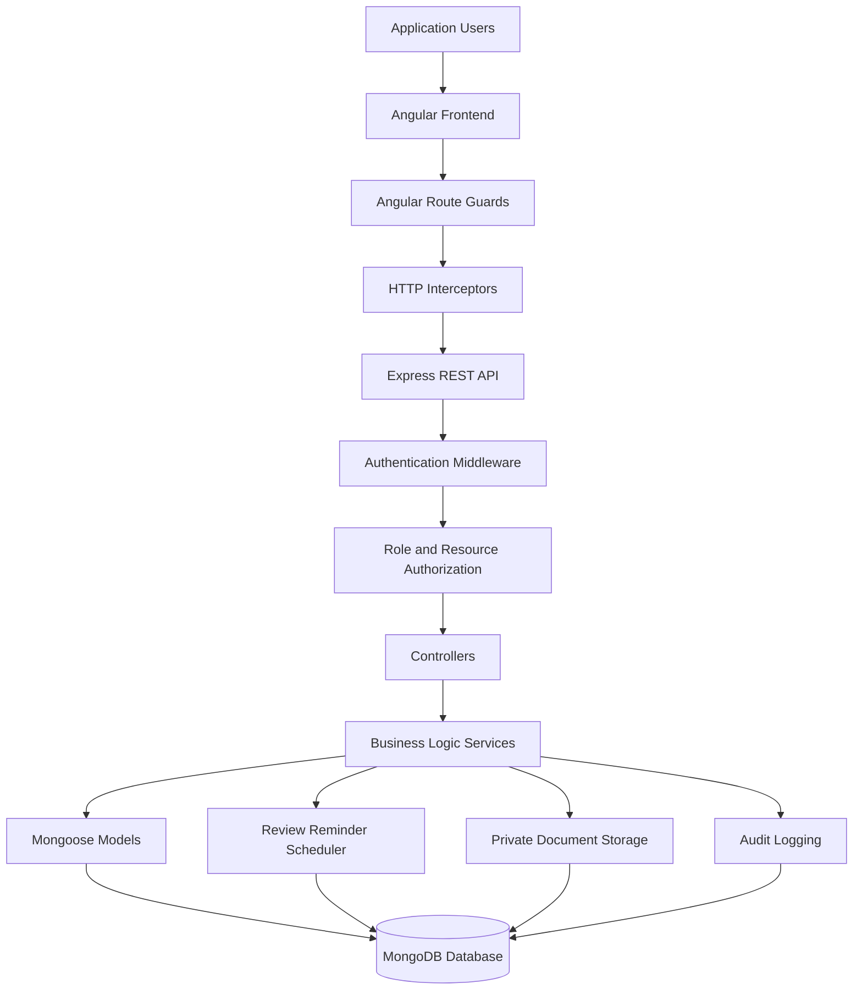

# Smart Hospital Management System
## System Architecture Document

**Project:** Smart Hospital Management System  
**Project Type:** MEAN Stack Internship Major Project  
**Version:** 1.0  
**Status:** Architecture Baseline

---

## 1. Project Overview

The Smart Hospital Management System is a web-based application designed to connect doctors, patients and medical/pharmacy staff through a centralized platform.

The system focuses on maintaining continuous patient care by providing:

- Patient profile management.
- Doctor–patient assignment.
- Longitudinal medical history and consultation records.
- Prescription management.
- Pharmacy inventory and medicine dispensing.
- Follow-up review scheduling and reminders.
- Patient–doctor messaging.
- Secure hospital and doctor document storage.
- Role-specific dashboards.

The application will be developed using the MEAN stack.

This is an educational prototype. Only synthetic demonstration data will be used. It is not intended for real clinical diagnosis, emergency response or production hospital operations.

## 2. Technology Stack

| Layer | Technology | Purpose |
|---|---|---|
| Frontend | Angular | User interface and role-based dashboards |
| Backend | Node.js | Server-side JavaScript runtime |
| Backend Framework | Express.js | REST API development |
| Database | MongoDB | NoSQL document database |
| ODM | Mongoose | MongoDB schema modelling and validation |
| Authentication | JWT | Secure user authentication |
| Password Security | bcrypt | Password hashing |
| Scheduled Jobs | node-cron | Review reminder processing |
| API Testing | Postman | API and authorization testing |
| Version Control | Git and GitHub | Source code management |

## 3. High-Level Architecture

The application follows a three-layer client-server architecture.

1. Presentation Layer – Angular frontend.
2. Application Layer – Node.js and Express.js backend.
3. Data Layer – MongoDB database.

The frontend communicates with the backend through REST APIs using JSON.

The backend validates requests, authenticates users, checks permissions, executes business logic and communicates with MongoDB through Mongoose.

### Architecture Diagram



### Request Flow

1. A user opens the Angular application.
2. The user logs in using registered credentials.
3. Angular sends login credentials to the Express backend.
4. The backend validates credentials and issues a JWT.
5. Angular stores and sends the token with protected API requests.
6. Express authentication middleware validates the token.
7. Authorization middleware checks the user's role and resource-level permissions.
8. The controller receives the authorized request.
9. The service performs the required business operation.
10. Mongoose reads or updates MongoDB.
11. The backend returns a structured JSON response.
12. Angular updates the user interface.

**Important:** Angular route guards are only for frontend navigation. All actual authorization must be enforced by the backend.

## 4. User Roles and Permissions

The application has three primary roles.

### 4.1 Doctor

Doctors can:

- View assigned patients.
- Access authorized patient profiles.
- View chronological medical history.
- Create consultation records.
- Finalize consultations.
- Release eligible consultation summaries to patients.
- Add amendments to finalized records.
- Create prescriptions.
- Schedule patient reviews.
- View upcoming and overdue reviews.
- Communicate with authorized patients.
- Access permitted document vault features.

### 4.2 Duty Doctor

Duty Doctor is not a separate primary role.

It is an additional permission assigned to an authorized doctor account.

Duty Doctors can:

- Access hospital-wide patient records within an authorized duty context.
- Review patient history for cross-coverage.
- Document duty consultations.
- Perform permitted clinical actions.

All cross-coverage access must be recorded in audit logs.

### 4.3 Patient

Patients can:

- Register and log in.
- View their own profile.
- Update permitted personal contact information.
- View their assigned doctor.
- View released medical summaries.
- View their own prescriptions.
- View upcoming reviews.
- Receive in-app notifications.
- Send and receive non-emergency messages.

Patients cannot access another patient's records or edit finalized clinical records.

### 4.4 Medical / Pharmacy Staff

Pharmacy staff can:

- View prescriptions awaiting dispensing.
- Search the medicine catalogue.
- Manage medicine batches.
- Record incoming stock.
- View available stock.
- Identify low-stock medicines.
- Identify expired and near-expiry batches.
- Dispense prescribed medicines.
- View dispensing history.

Pharmacy users cannot access full clinical notes or the private document vault.

### Account Creation

- Patients may self-register.
- Doctor and pharmacy accounts must be created or approved through an authorized hospital process.
- Demonstration accounts will be created using a database seed script.
- No additional ADMIN primary application role will be introduced without approval.

## 5. Backend Architecture

The backend will use a layered architecture to separate responsibilities and keep business logic maintainable.

### Recommended Folder Structure

```text
backend/
│
├── src/
│   ├── config/
│   │   ├── db.js
│   │   ├── env.js
│   │   └── storage.js
│   │
│   ├── models/
│   │   ├── User.js
│   │   ├── Patient.js
│   │   ├── Doctor.js
│   │   ├── DoctorAssignment.js
│   │   ├── MedicalRecord.js
│   │   ├── Prescription.js
│   │   ├── Medicine.js
│   │   ├── MedicineBatch.js
│   │   ├── StockTransaction.js
│   │   ├── ReviewSchedule.js
│   │   ├── Notification.js
│   │   ├── Conversation.js
│   │   ├── Message.js
│   │   ├── DocumentVault.js
│   │   └── AuditLog.js
│   │
│   ├── routes/
│   │   ├── auth.routes.js
│   │   ├── patient.routes.js
│   │   ├── doctor.routes.js
│   │   ├── assignment.routes.js
│   │   ├── medicalRecord.routes.js
│   │   ├── prescription.routes.js
│   │   ├── medicine.routes.js
│   │   ├── dispensing.routes.js
│   │   ├── review.routes.js
│   │   ├── notification.routes.js
│   │   ├── conversation.routes.js
│   │   └── vault.routes.js
│   │
│   ├── controllers/
│   ├── services/
│   ├── middleware/
│   │   ├── auth.middleware.js
│   │   ├── role.middleware.js
│   │   ├── resourceAccess.middleware.js
│   │   ├── validation.middleware.js
│   │   └── error.middleware.js
│   │
│   ├── validators/
│   ├── jobs/
│   │   └── reviewReminder.job.js
│   │
│   ├── utils/
│   ├── scripts/
│   │   └── seed.js
│   │
│   ├── app.js
│   └── server.js
│
├── uploads/
│   └── vault/
│
├── tests/
├── .env
├── .env.example
├── .gitignore
└── package.json
```

The exact structure may be refined during implementation, but the separation between routes, controllers, services, models and middleware must be maintained.

### Backend Layer Responsibilities

**Routes**
- Define API endpoints.
- Connect endpoints to controllers.
- Apply authentication and authorization middleware.

**Controllers**
- Receive HTTP requests.
- Extract request parameters and body data.
- Call the appropriate service.
- Return HTTP responses.

**Services**
- Contain business logic.
- Enforce application rules.
- Coordinate database operations.
- Handle workflows involving multiple collections.

**Models**
- Define Mongoose schemas.
- Specify field types and validation.
- Define references and indexes.

**Middleware**
- Authenticate users.
- Check role permissions.
- Validate resource access.
- Validate requests.
- Handle errors.

**Jobs**
- Execute scheduled background operations.
- Process review reminders.

## 6. Frontend Architecture

The frontend will use Angular with a feature-based structure.

### Recommended Folder Structure

```text
frontend/
│
├── src/
│   ├── app/
│   │   ├── core/
│   │   │   ├── auth/
│   │   │   ├── guards/
│   │   │   ├── interceptors/
│   │   │   └── services/
│   │   │
│   │   ├── shared/
│   │   │   ├── components/
│   │   │   ├── pipes/
│   │   │   └── validators/
│   │   │
│   │   ├── features/
│   │   │   ├── authentication/
│   │   │   ├── doctor/
│   │   │   ├── patient/
│   │   │   ├── pharmacy/
│   │   │   ├── medical-history/
│   │   │   ├── prescriptions/
│   │   │   ├── reviews/
│   │   │   ├── notifications/
│   │   │   ├── messaging/
│   │   │   └── document-vault/
│   │   │
│   │   ├── app.routes.ts
│   │   └── app.config.ts
│   │
│   ├── assets/
│   ├── environments/
│   └── styles/
│
├── angular.json
├── package.json
└── tsconfig.json
```

### Frontend Responsibilities

- Display role-specific dashboards.
- Provide registration and login forms.
- Display patient profiles and medical timelines.
- Provide consultation and prescription forms.
- Display review schedules and notifications.
- Provide pharmacy inventory interfaces.
- Provide patient–doctor messaging interfaces.
- Provide authorized document vault interfaces.
- Validate user input.
- Communicate with backend APIs.

### Angular Core Components

**Authentication Service**
- Manages login and logout.
- Handles authentication state.
- Provides access to the authenticated user's profile.

**HTTP Interceptor**
- Attaches the JWT to protected API requests.
- Handles common authentication errors.

**Route Guards**
- Prevent unauthorized navigation.
- Restrict frontend routes according to roles.

**Shared Components**
- Reusable forms, tables, navigation elements, loading indicators and alerts.

## 7. Major Application Modules

### Module 1: Authentication and User Management

- Patient registration.
- Login and logout.
- JWT authentication.
- Password hashing.
- Role-based authorization.
- Account activation/deactivation.
- User profile management.

### Module 2: Patient and Doctor Management

- Patient profiles.
- Doctor profiles.
- Patient search.
- Doctor–patient assignment.
- Assignment history.
- Reassignment support.

### Module 3: Medical History and Consultations

- Chronological medical timeline.
- Consultation creation.
- Symptoms and observations.
- Diagnosis and notes.
- Treatment plans.
- Consultation finalization.
- Patient-visible record release.
- Auditable amendments.

### Module 4: Prescription Management

- Prescription creation.
- Medicine selection.
- Dosage and frequency.
- Duration and quantity.
- Prescription status.
- Pharmacy dispensing queue.

### Module 5: Review Scheduling and Notifications

- Review creation.
- Review date and time.
- Instructions.
- Two-calendar-day reminder scheduling.
- Reminder rescheduling and cancellation.
- In-app notifications.
- Notification read status.

### Module 6: Pharmacy and Inventory

- Medicine catalogue.
- Batch management.
- Stock receipts.
- Available stock.
- Low-stock alerts.
- Expiry alerts.
- Prescription dispensing.
- Stock transaction history.

### Module 7: Patient–Doctor Messaging

- Messaging is one-to-one between a patient and their active treating doctor. Patients identify themselves from authentication; doctors must provide a patient ID and have an active `TREATING` assignment.
- `DUTY_DOCTOR` permission does not grant messaging access. Pharmacy users are denied.
- Each patient-doctor pair has one conversation. On reassignment, the patient retains their old history, the previous doctor loses access, and the newly assigned doctor receives a separate conversation.
- Messages derive sender and recipient from the authenticated user and conversation participants. They are immutable through the MVP API; only the recipient can mark a message as read.
- Conversation and message history are paginated and returned in chronological order. Message bodies are limited to 4,000 characters.
- The UI must display a non-emergency disclaimer.

Messaging will use REST-based asynchronous communication. WebSocket functionality and real-time presence are not required.

The API provides `POST /api/conversations`, `GET /api/conversations`, `GET /api/conversations/:id/messages`, `POST /api/conversations/:id/messages`, and `PATCH /api/conversations/:id/messages/:messageId/read`. Conversation creation, message sending, and read-state changes commit with their audit records in a MongoDB transaction; these mutations fail closed unless MongoDB is a replica set or sharded deployment. Sensitive list/history access is audited before its response is returned. Audit actions include `CONVERSATION_CREATED`, `CONVERSATION_ACCESSED`, `CONVERSATIONS_ACCESSED`, `MESSAGES_ACCESSED`, `MESSAGE_SENT`, `MESSAGE_READ`, and `MESSAGING_ACCESS_DENIED`. Audit events include actor, outcome and IP attribution but never message bodies.

MVP limitations: no group conversations, message edits/deletes, attachments, emergency messaging, video, WebSockets, or real-time presence.

### Module 8: Secure Document Vault

- `POST /api/vault/documents` accepts one multipart field named `file`; uploads are limited to 5 MiB and PDF, PNG, or JPEG content whose signature, MIME type, and extension agree.
- `GET /api/vault/documents?page=&limit=` lists only active documents uploaded by the authenticated doctor. `GET /api/vault/documents/:id/download` streams an owned file, and `DELETE /api/vault/documents/:id` soft-deletes its metadata.
- Every endpoint requires an authenticated `DOCTOR` user with `VAULT_ACCESS` and an active doctor profile. Patient and pharmacy users are denied; one doctor cannot access another doctor's documents.
- Storage keys are server-generated and private. The API returns no storage key or filesystem path. Files are stored outside public/static directories and are never served through Express static middleware.
- Upload metadata and its audit event use a MongoDB transaction. Upload files are staged and removed after a verified rollback; filesystem writes themselves do not participate in the database transaction. If a transaction's final outcome cannot be verified, the file is retained rather than risk a database record pointing to a missing file. Upload and soft-delete mutations fail closed unless MongoDB transactions are available.
- List, upload, download, delete, and authenticated denials are audited with actor, outcome, and IP where available. Audit events do not contain file contents, storage keys, or paths.
- `VAULT_STORAGE_PATH` defaults to `backend/uploads/vault`; relative paths resolve from the backend directory. Configure a private persistent volume outside all public directories in production. The application does not encrypt files at rest. Soft deletion prevents further API access but does not physically erase the file; storage retention and secure erasure require an operational policy.

### Module 9: Dashboards

**Doctor Dashboard**
- Assigned patient count.
- Today's consultations.
- Upcoming reviews.
- Overdue reviews.
- Pending messages.

**Patient Dashboard**
- Assigned doctor.
- Released medical history.
- Prescriptions.
- Upcoming reviews.
- Notifications.

**Pharmacy Dashboard**
- Pending prescriptions.
- Stock summary.
- Low-stock medicines.
- Expired and near-expiry batches.
- Dispensing history.

## 8. Important Business Workflows

### Workflow A: Patient Registration and Assignment

1. Patient registers.
2. Backend creates the user account and patient profile.
3. Authorized workflow assigns the patient to a doctor.
4. Assignment is stored with start date and status.
5. Doctor can access the assigned patient's profile.

### Workflow B: Consultation and Medical History

1. Doctor opens an authorized patient profile.
2. Doctor reviews previous consultations.
3. Doctor creates a new consultation.
4. Doctor enters clinical information.
5. Doctor saves the consultation as a draft.
6. Doctor finalizes the consultation.
7. Doctor releases the summary when appropriate.
8. Patient can view the record only when finalized and released.

### Workflow C: Prescription and Dispensing

1. Doctor creates a prescription linked to a consultation.
2. Pharmacy receives the prescription in its pending queue.
3. Pharmacy checks available medicine batches.
4. Pharmacy selects valid batches.
5. Pharmacy records the actual quantity dispensed.
6. Backend validates stock and batch expiry.
7. Stock is updated.
8. A stock transaction is recorded.

Prescription creation alone must never reduce stock.

### Workflow D: Review and Reminder

1. Doctor schedules a patient review.
2. Backend calculates the reminder time using the configured hospital timezone.
3. A notification is scheduled for two calendar days before the review.
4. The scheduled job processes due reminders.
5. The patient receives an in-app notification.
6. The patient can mark the notification as read.
7. Rescheduled reviews update pending reminders.
8. Cancelled reviews cancel pending reminders.

### Workflow E: Secure Document Vault

1. An authenticated doctor with `VAULT_ACCESS` requests the document list.
2. The backend verifies the active doctor profile and returns only that doctor's active metadata.
3. The doctor uploads one supported file; the backend checks size, filename, signature, MIME type, and extension.
4. The backend writes a server-named file to private staging, then persists metadata and the audit event in a transaction.
5. On verified metadata/audit rollback, the staged or final file is removed. If transaction outcome verification fails, the private file is retained for safe reconciliation; cleanup failures are surfaced and logged without recording a path.
6. For download, the backend rechecks owner and active status before opening and streaming the private file with no-store and nosniff headers.
7. Deletion changes metadata to `DELETED`; the stored file remains for separately managed retention/erasure.

### Workflow F: Patient–Doctor Messaging

1. Patient opens an authorized conversation.
2. Patient sends a message.
3. Backend verifies the patient–doctor relationship.
4. Message is stored with sender and timestamp.
5. Authorized doctor views and replies.
6. Read status is updated.

## 9. Authentication and Security Architecture

The system must implement:

- JWT-based authentication.
- bcrypt password hashing.
- Role-based access control.
- Resource-level authorization.
- Protected Express routes.
- Angular route guards.
- HTTP interceptors.
- Request validation and sanitization.
- Secure HTTP headers.
- CORS allowlisting.
- Authentication rate limiting.
- Private document storage.
- Audit logging.
- Environment-based secret management.

The backend must never trust patient IDs, doctor IDs, roles or permissions provided by the frontend without verifying them against the authenticated user and database.

### Medical Record Protection

- Draft records are not visible to patients.
- Finalized records cannot be silently overwritten.
- Patient visibility requires both FINALIZED status and explicit release.
- Corrections must be recorded as amendments.
- Sensitive record access must be auditable.

### Inventory Protection

- Stock cannot become negative.
- Expired batches cannot be dispensed.
- Dispensing must update inventory and record a stock transaction.
- Stock updates should use atomic database operations or transactions where supported.

### Vault Protection

- Files must be stored outside public folders.
- User-supplied filenames must not be used as storage paths.
- File type and size must be validated.
- Only authorized doctors may list, upload and download documents.
- Upload, download and deletion events must be audited.

## 10. Scheduled Reminder Architecture

The backend will use a scheduled job, such as node-cron, to process due review reminders.

The job will:

1. Find active reviews with due scheduled reminders.
2. Verify that the review has not been cancelled.
3. Check that a notification has not already been sent.
4. Create or update the notification.
5. Mark the reminder as sent.
6. Record failures for safe retry handling.

A unique deduplication key must prevent duplicate notifications.

A development-only test mechanism may be provided to demonstrate reminder processing without waiting two days. It must not be exposed as an unrestricted production endpoint.

Review creation, rescheduling, cancellation, completion, reminder delivery, and notification-read state changes must commit atomically with their audit records. These operations require a MongoDB replica set or sharded deployment; they fail closed on standalone MongoDB. Reminder delivery updates the notification and review state in the same transaction so failures remain eligible for retry. The cron job starts once from the backend entry point and is disabled in the test environment.

## 11. API Architecture

The backend will expose REST APIs under `/api`.

| Module | Example endpoint | Purpose |
|---|---|---|
| Authentication | `/api/auth/login` | User login |
| Authentication | `/api/auth/register` | Patient registration |
| Authentication | `/api/auth/me` | Current user |
| Patients | `GET /api/patients` | List records visible to the patient, assigned doctor, or duty doctor |
| Patients | `GET /api/patients/:id` | Retrieve an authorized patient profile |
| Assignments | `/api/assignments` | Create assignment |
| Medical History | `/api/patients/:id/medical-records` | Patient history |
| Medical History | `/api/medical-records` | Create consultation |
| Prescriptions | `GET /api/prescriptions/pending` | Pharmacy dispensing queue |
| Prescriptions | `POST /api/prescriptions` | Create prescription linked to a consultation (deferred; consultation API/model is not implemented) |
| Reviews | `POST /api/reviews`, `GET /api/reviews/upcoming` | Schedule and list reviews; doctors may optionally filter upcoming results by an authorized `patientId` |
| Notifications | `/api/notifications/my` | User notifications |
| Medicines | `GET /api/medicines` | Search medicine catalogue |
| Medicines | `GET /api/medicines/availability` | View batch expiry and usable stock |
| Dispensing | `POST /api/dispensing` | Dispense a pending/partially dispensed prescription |
| Inventory | `POST /api/stock/receipts` | Record received stock |
| Messaging | `POST /api/conversations` | Create or retrieve the authenticated participant's conversation |
| Messaging | `GET /api/conversations?page=&limit=` | List only the authenticated patient's or currently assigned doctor's conversations |
| Messaging | `GET /api/conversations/:id/messages?page=&limit=` | Retrieve authorized, chronological message history |
| Messaging | `POST /api/conversations/:id/messages` | Send a message; sender and recipient are server-derived |
| Messaging | `PATCH /api/conversations/:id/messages/:messageId/read` | Mark a message read as its recipient |
| Vault | `/api/vault/documents` | List and upload documents |

All endpoints must validate requests, apply authorization and return consistent JSON responses.

The pharmacy catalogue, availability, queue, receipt and dispensing endpoints require an authenticated `PHARMACY` user. Inventory mutations require MongoDB replica-set or sharded transactions; they fail closed on standalone deployments. Prescription creation remains unavailable until consultation records can be created and validated. Medicine catalogue records must be provisioned outside these read-only catalogue endpoints.

## 12. API Response Format

Recommended successful response:

```json
{
  "success": true,
  "message": "Operation completed successfully",
  "data": {}
}
```

Recommended error response:

```json
{
  "success": false,
  "message": "Validation failed",
  "errors": []
}
```

Common HTTP status codes:

| Status | Meaning |
|---|---|
| 200 | Successful request |
| 201 | Resource created |
| 400 | Invalid request |
| 401 | Authentication required |
| 403 | Access forbidden |
| 404 | Resource not found |
| 409 | Resource or data conflict |
| 500 | Internal server error |

## 13. Development and Testing Strategy

Development will follow an incremental module-based approach.

Each module must follow this cycle:

1. Understand requirements.
2. Design the data model.
3. Implement backend APIs.
4. Test APIs using Postman.
5. Implement the Angular interface.
6. Integrate frontend and backend.
7. Test normal and unauthorized scenarios.
8. Fix errors.
9. Commit and push completed work to GitHub.

### Git Commit Convention

Use meaningful commit messages:

```text
docs: add system architecture
docs: add database design
chore: initialize MEAN stack project
feat: configure MongoDB connection
feat: implement JWT authentication
feat: add patient management
feat: implement medical history
feat: add review reminder scheduling
feat: implement pharmacy inventory
test: add authorization tests
fix: prevent duplicate reminders
```

## 14. Implementation Priority

The project will be implemented in the following order:

| Phase | Module | Priority |
|---|---|---|
| 1 | Project initialization and configuration | Critical |
| 2 | MongoDB connection and schemas | Critical |
| 3 | Authentication and role authorization | Critical |
| 4 | Patient and doctor profiles | Critical |
| 5 | Doctor–patient assignments | Critical |
| 6 | Medical history and consultations | Critical |
| 7 | Prescriptions | Critical |
| 8 | Pharmacy inventory and dispensing | Critical |
| 9 | Review scheduling and reminders | Critical |
| 10 | Angular dashboards | High |
| 11 | Messaging | High |
| 12 | Document vault | High |
| 13 | Testing, documentation and final integration | Critical |

The order may be adjusted where dependencies require it, while preserving the BRD's mandatory functionality.

## 15. Deployment and Environment Configuration

The application will use environment variables for configuration.

Example backend `.env.example`:

```env
PORT=5000
NODE_ENV=development
MONGODB_URI=mongodb://127.0.0.1:27017/smart_hospital
JWT_SECRET=replace_with_a_secure_secret
JWT_EXPIRES_IN=1d
CLIENT_URL=http://localhost:4200
HOSPITAL_TIMEZONE=Asia/Kolkata
VAULT_STORAGE_PATH=uploads/vault
```

Actual secrets must never be committed to GitHub.

The vault storage path must resolve outside Express-served/public directories. Relative paths resolve from the backend directory. Use a private persistent volume with appropriate operating-system permissions; application-level encryption at rest is not implemented.

The frontend and backend will run as separate development applications and communicate through the configured API URL.

## 16. Project Constraints

- Development duration: 15 calendar working days as defined by the internship schedule.
- Frontend: Angular.
- Backend: Node.js and Express.js.
- Database: MongoDB and Mongoose.
- Primary roles: Doctor, Patient and Pharmacy.
- Duty Doctor is an additional permission.
- Only synthetic demonstration data may be used.
- No real patient information or actual government certificates.
- No automated diagnosis or treatment recommendations.
- No payments, insurance, laboratory integration, inpatient management or emergency dispatch.
- No native mobile application or video consultation.
- No production deployment or certification is assumed.

## 17. Final Architecture Objective

The final application must provide a working end-to-end hospital workflow:

Patient Registration → Doctor Assignment → Consultation → Prescription → Pharmacy Dispensing → Review Scheduling → Patient Notification.

The system must enforce role-based and resource-level access, maintain historical records, protect private documents, prevent invalid stock updates and record sensitive operations in audit logs.

The architecture should remain modular, understandable and testable throughout the internship.