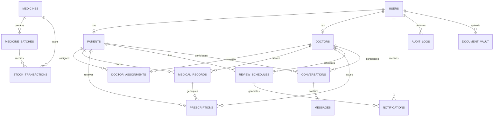

# Smart Hospital Management System
## Database Design Document

**Project:** Smart Hospital Management System  
**Database:** MongoDB  
**ODM:** Mongoose  
**Version:** 1.0  
**Status:** Database Design Baseline

---

## 1. Introduction

The Smart Hospital Management System uses MongoDB as its primary database and Mongoose as its Object Data Modeling (ODM) library.

The database is designed to store and manage:

- User accounts and authentication information.
- Patient and doctor profiles.
- Doctor–patient assignments.
- Medical records and consultations.
- Prescriptions.
- Medicine catalogue and batch inventory.
- Stock transactions.
- Review schedules.
- Notifications.
- Patient–doctor conversations and messages.
- Private document metadata.
- Audit logs.

The database design follows a modular structure to maintain data integrity, support efficient queries and enforce access boundaries.

## 2. Database Configuration

**Database name:** `smart_hospital`

**Connection:** MongoDB connection configured through an environment variable.

Example:

```env
MONGODB_URI=mongodb://127.0.0.1:27017/smart_hospital
```

The application will use Mongoose to define schemas, references, validation rules and indexes.

### General Database Standards

1. Use MongoDB ObjectId as the primary identifier for documents.
2. Use references to connect related collections.
3. Enable `timestamps: true` where appropriate.
4. Use schema-level validation.
5. Create indexes for frequently searched fields.
6. Store dates consistently in UTC.
7. Use the configured hospital timezone for reminder scheduling and date display.
8. Avoid unnecessary duplication of sensitive clinical information.
9. Use synthetic demonstration data only.

## 3. Database Collections Overview

The application will use the following MongoDB collections.

| No. | Collection | Purpose |
|---|---|---|
| 1 | users | Authentication and user account information |
| 2 | patients | Patient profile information |
| 3 | doctors | Doctor profile information |
| 4 | doctorAssignments | Patient–doctor assignment history |
| 5 | medicalRecords | Consultation and medical history |
| 6 | prescriptions | Doctor-issued prescriptions |
| 7 | medicines | Medicine catalogue |
| 8 | medicineBatches | Batch-level medicine inventory |
| 9 | stockTransactions | Stock receipts and dispensing history |
| 10 | reviewSchedules | Follow-up review scheduling |
| 11 | notifications | In-app notifications and reminders |
| 12 | conversations | Patient–doctor conversation details |
| 13 | messages | Individual messages |
| 14 | documentVault | Private document metadata |
| 15 | auditLogs | Sensitive activity and operation logs |

## 4. Collection Design

### 4.1 Users Collection

**Collection:** `users`

**Purpose:** Stores authentication credentials, roles, permissions and account status for all application users.

**Fields:**

| Field | Data Type | Description |
|---|---|---|
| _id | ObjectId | Unique user identifier |
| name | String | User's full name |
| email | String | Unique email address |
| passwordHash | String | Hashed password |
| role | String | DOCTOR, PATIENT or PHARMACY |
| permissions | Array of String | Additional permissions, such as DUTY_DOCTOR or vault access |
| status | String | ACTIVE or INACTIVE |
| lastLoginAt | Date | Most recent successful login |
| createdAt | Date | Account creation timestamp |
| updatedAt | Date | Last update timestamp |

**Validation Rules:**

- Email must be unique.
- Email must be stored in a normalized format.
- Passwords must be hashed using bcrypt or an equivalent approved password-hashing algorithm.
- Plain-text passwords must never be stored.
- Role must be one of the three primary roles.
- Only authorized doctor accounts may receive additional doctor-specific permissions.
- Inactive accounts must not be allowed to access protected application features.

**Example Document:**

```json
{
  "_id": "ObjectId",
  "name": "Demo Doctor",
  "email": "doctor@example.com",
  "passwordHash": "hashed_password",
  "role": "DOCTOR",
  "permissions": ["DUTY_DOCTOR", "VAULT_ACCESS"],
  "status": "ACTIVE",
  "lastLoginAt": null
}
```

The example credentials and identifiers are illustrative only.

### 4.2 Patients Collection

**Collection:** `patients`

**Purpose:** Stores patient profile information separately from authentication credentials.

**Fields:**

| Field | Data Type | Description |
|---|---|---|
| _id | ObjectId | Patient identifier |
| userId | ObjectId | Reference to users |
| patientNumber | String | Unique patient registration number |
| name | String | Patient's full name |
| dateOfBirth | Date | Date of birth |
| contactNumber | String | Contact number |
| address | String | Residential address |
| gender | String | Optional demographic information |
| status | String | ACTIVE or INACTIVE |
| createdAt | Date | Profile creation timestamp |
| updatedAt | Date | Last update timestamp |

**Validation Rules:**

- `userId` must reference a PATIENT account.
- `patientNumber` must be unique.
- Patient records must be accessible only to the authenticated patient and authorized doctors.
- Patients may update only permitted profile fields.

### 4.3 Doctors Collection

**Collection:** `doctors`

**Purpose:** Stores professional information about doctors.

**Fields:**

| Field | Data Type | Description |
|---|---|---|
| _id | ObjectId | Doctor identifier |
| userId | ObjectId | Reference to users |
| doctorNumber | String | Unique doctor identifier |
| name | String | Doctor's full name |
| specialization | String | Medical specialization |
| registrationReference | String | Professional registration reference |
| department | String | Department name |
| status | String | ACTIVE or INACTIVE |
| createdAt | Date | Profile creation timestamp |
| updatedAt | Date | Last update timestamp |

**Validation Rules:**

- `userId` must reference a DOCTOR account.
- `doctorNumber` must be unique.
- Doctor permissions must be managed through the associated user account.
- Only active, authorized doctors may perform clinical operations.

### 4.4 Doctor Assignments Collection

**Collection:** `doctorAssignments`

**Purpose:** Maintains the relationship between doctors and patients, including historical assignments and reassignment.

**Fields:**

| Field | Data Type | Description |
|---|---|---|
| _id | ObjectId | Assignment identifier |
| patientId | ObjectId | Reference to patients |
| doctorId | ObjectId | Reference to doctors |
| assignmentType | String | Assignment category |
| startDate | Date | Assignment start date |
| endDate | Date | Assignment end date |
| status | String | ACTIVE or CLOSED |
| assignedBy | ObjectId | Reference to the user who created the assignment |
| createdAt | Date | Assignment creation timestamp |
| updatedAt | Date | Last update timestamp |

**Business Rules:**

- A patient can have multiple historical assignments.
- The active treating-doctor assignment must be unambiguous unless a care-team model is explicitly configured.
- Reassignment must close the previous assignment.
- Historical assignments must never be deleted simply because a patient changes doctors.
- Treating doctors may access their assigned patients.
- Authorized Duty Doctors may access hospital-wide patient records within the permitted duty context.

### 4.5 Medical Records Collection

**Collection:** `medicalRecords`

**Purpose:** Stores consultation details and maintains the patient's chronological medical history.

**Fields:**

| Field | Data Type | Description |
|---|---|---|
| _id | ObjectId | Medical record identifier |
| patientId | ObjectId | Reference to patients |
| doctorId | ObjectId | Reference to doctors |
| encounterDate | Date | Consultation date and time |
| reason | String | Reason for consultation |
| symptoms | String | Patient symptoms |
| observations | String | Clinical observations |
| diagnosis | String | Recorded diagnosis |
| notes | String | Clinical notes |
| treatmentPlan | String | Treatment plan |
| status | String | DRAFT or FINALIZED |
| isReleased | Boolean | Controls patient visibility |
| releasedAt | Date | Date and time of release |
| amendments | Array of Object | Auditable corrections |
| createdAt | Date | Record creation timestamp |
| updatedAt | Date | Last update timestamp |

**Amendment Object:**

| Field | Data Type | Description |
|---|---|---|
| authorId | ObjectId | User who made the amendment |
| reason | String | Reason for correction |
| changes | Object | Description of corrected information |
| createdAt | Date | Amendment timestamp |

**Important Record Visibility Rule:**

The record status and patient visibility are separate concepts.

| Status | isReleased | Patient Access |
|---|---|---|
| DRAFT | false | Not visible |
| FINALIZED | false | Not visible |
| FINALIZED | true | Visible |
| DRAFT | true | Not permitted |

Only records that are both `FINALIZED` and explicitly released may appear on the patient's dashboard.

**Business Rules:**

- Every new consultation creates a separate medical record.
- New consultations must not overwrite previous finalized consultations.
- Finalized records cannot be silently edited.
- Corrections must be stored as amendments with author, reason and timestamp.
- Patients may view only their own released medical records.
- Doctors must pass resource-level authorization before viewing patient history.

### 4.6 Prescriptions Collection

**Collection:** `prescriptions`

**Purpose:** Stores prescriptions created by authorized doctors.

**Fields:**

| Field | Data Type | Description |
|---|---|---|
| _id | ObjectId | Prescription identifier |
| patientId | ObjectId | Reference to patients |
| doctorId | ObjectId | Reference to doctors |
| medicalRecordId | ObjectId | Reference to medicalRecords |
| items | Array of Object | Prescribed medicines |
| issuedAt | Date | Prescription issue date |
| status | String | Prescription status |
| createdAt | Date | Creation timestamp |
| updatedAt | Date | Last update timestamp |

**Prescription Item Object:**

| Field | Data Type | Description |
|---|---|---|
| medicineId | ObjectId | Reference to medicines |
| dosage | String | Prescribed dosage |
| route | String | Administration route, if applicable |
| frequency | String | Frequency of use |
| duration | String | Treatment duration |
| quantity | Number | Prescribed quantity |
| instructions | String | Additional instructions |

**Suggested Prescription Statuses:**

- PENDING
- PARTIALLY_DISPENSED
- DISPENSED
- CANCELLED

**Business Rules:**

- Each prescription must be linked to a patient and prescribing doctor.
- Prescription creation must not reduce medicine stock.
- Prescription changes after finalization must be handled through cancellation/reissue or auditable amendments.
- Pharmacy users may access prescriptions for dispensing but not unrelated clinical notes.

### 4.7 Medicines Collection

**Collection:** `medicines`

**Purpose:** Stores the medicine catalogue.

**Fields:**

| Field | Data Type | Description |
|---|---|---|
| _id | ObjectId | Medicine identifier |
| name | String | Medicine name |
| genericName | String | Generic medicine name |
| strength | String | Medicine strength |
| form | String | Tablet, capsule, syrup, etc. |
| manufacturer | String | Manufacturer name |
| reorderLevel | Number | Minimum desired stock level |
| active | Boolean | Catalogue availability |
| createdAt | Date | Creation timestamp |
| updatedAt | Date | Last update timestamp |

**Business Rules:**

- Medicine names and details must be validated.
- Reorder levels must be non-negative.
- Medicines should be referenced by prescriptions and inventory batches.
- Medicine catalogue records should not be deleted if they are referenced by historical prescriptions.

### 4.8 Medicine Batches Collection

**Collection:** `medicineBatches`

**Purpose:** Tracks medicine inventory at batch level.

**Fields:**

| Field | Data Type | Description |
|---|---|---|
| _id | ObjectId | Batch identifier |
| medicineId | ObjectId | Reference to medicines |
| batchNumber | String | Manufacturer batch number |
| expiryDate | Date | Batch expiry date |
| receivedQuantity | Number | Original quantity received |
| availableQuantity | Number | Current available quantity |
| receivedAt | Date | Stock receipt date |
| supplierReference | String | Optional supplier reference |
| createdAt | Date | Creation timestamp |
| updatedAt | Date | Last update timestamp |

**Business Rules:**

- Batch numbers must be recorded.
- Available quantity cannot become negative.
- Expired batches cannot be dispensed.
- Near-expiry batches should be identifiable.
- Every stock change must be associated with a stock transaction.
- Batch availability must be checked before dispensing.

### 4.9 Stock Transactions Collection

**Collection:** `stockTransactions`

**Purpose:** Maintains an auditable history of inventory changes.

**Fields:**

| Field | Data Type | Description |
|---|---|---|
| _id | ObjectId | Transaction identifier |
| medicineId | ObjectId | Reference to medicines |
| batchId | ObjectId | Reference to medicineBatches |
| prescriptionId | ObjectId | Optional reference to prescriptions |
| transactionType | String | RECEIPT or DISPENSING |
| quantity | Number | Quantity added or deducted |
| actorId | ObjectId | User who performed the operation |
| timestamp | Date | Transaction timestamp |
| reason | String | Transaction description |
| createdAt | Date | Record creation timestamp |

**Business Rules:**

- Stock receipt increases available quantity.
- Dispensing decreases available quantity.
- Every dispensing operation must create a transaction.
- The actor must be an authenticated pharmacy user.
- Negative stock is prohibited.
- Stock updates and transaction creation should be performed atomically where supported.

### 4.10 Review Schedules Collection

**Collection:** `reviewSchedules`

**Purpose:** Stores follow-up review appointments created by doctors.

**Fields:**

| Field | Data Type | Description |
|---|---|---|
| _id | ObjectId | Review identifier |
| patientId | ObjectId | Reference to patients |
| doctorId | ObjectId | Reference to doctors |
| reviewDate | Date | Scheduled review date and time |
| instructions | String | Review instructions |
| status | String | SCHEDULED, COMPLETED or CANCELLED |
| reminderStatus | String | Reminder processing status |
| createdAt | Date | Creation timestamp |
| updatedAt | Date | Last update timestamp |

**Business Rules:**

- Reviews must be associated with a patient and responsible doctor.
- Reminder time must be calculated as two calendar days before the review using the configured hospital timezone.
- Rescheduling must update pending reminders.
- Cancellation must cancel pending reminders.
- Reminder delivery must be idempotent.
- Doctors may view upcoming and overdue reviews for authorized patients.

### 4.11 Notifications Collection

**Collection:** `notifications`

**Purpose:** Stores in-app notifications, especially patient review reminders.

**Fields:**

| Field | Data Type | Description |
|---|---|---|
| _id | ObjectId | Notification identifier |
| recipientId | ObjectId | Reference to users |
| reviewId | ObjectId | Optional reference to reviewSchedules |
| type | String | Notification category |
| title | String | Notification title |
| message | String | Notification content |
| scheduledAt | Date | Scheduled delivery time |
| sentAt | Date | Actual delivery time |
| readAt | Date | Time notification was read |
| status | String | SCHEDULED, SENT, READ, FAILED or CANCELLED |
| deduplicationKey | String | Unique key preventing duplicate delivery |
| createdAt | Date | Creation timestamp |
| updatedAt | Date | Last update timestamp |

**Business Rules:**

- Notifications must belong to the intended recipient.
- Patients may access only their own notifications.
- A notification must not be delivered twice.
- Read status must be updated when the recipient reads it.
- Cancelled reviews must not generate pending reminders.
- Failed notifications should be handled safely without creating duplicates.

### 4.12 Conversations Collection

**Collection:** `conversations`

**Purpose:** Stores patient–doctor conversation information.

**Fields:**

| Field | Data Type | Description |
|---|---|---|
| _id | ObjectId | Conversation identifier |
| patientId | ObjectId | Reference to patients |
| doctorId | ObjectId | Reference to doctors |
| status | String | ACTIVE or CLOSED |
| lastMessageAt | Date | Timestamp of most recent message |
| createdAt | Date | Conversation creation timestamp |
| updatedAt | Date | Last update timestamp |

**Business Rules:**

- A conversation must be associated with an authorized patient–doctor relationship.
- Only authorized participants may access the conversation.
- Conversation history must be retained.
- Messaging is non-emergency communication.

### 4.13 Messages Collection

**Collection:** `messages`

**Purpose:** Stores individual messages exchanged within conversations.

**Fields:**

| Field | Data Type | Description |
|---|---|---|
| _id | ObjectId | Message identifier |
| conversationId | ObjectId | Reference to conversations |
| senderId | ObjectId | Reference to users |
| body | String | Message content |
| createdAt | Date | Message timestamp |
| readAt | Date | Read timestamp, if applicable |
| status | String | SENT or READ |

**Business Rules:**

- Every message must belong to a valid conversation.
- Sender identity must be derived from the authenticated user.
- Only conversation participants may access messages.
- Messages must retain sender and timestamp information.
- The interface must display the mandatory non-emergency notice.

### 4.14 Document Vault Collection

**Collection:** `documentVault`

**Purpose:** Stores metadata for private hospital and doctor documents.

Actual files are stored in private backend storage, not directly inside MongoDB or public static folders.

**Fields:**

| Field | Data Type | Description |
|---|---|---|
| _id | ObjectId | Document identifier |
| category | String | Document category |
| title | String | Document title |
| issuingAuthority | String | Optional issuing authority |
| referenceNumber | String | Optional reference number |
| issueDate | Date | Optional issue date |
| expiryDate | Date | Optional expiry date |
| storageKey | String | Generated private storage identifier |
| originalFilename | String | Original filename for display |
| mimeType | String | Validated file type |
| fileSize | Number | File size in bytes |
| uploadedBy | ObjectId | Reference to users |
| uploadedAt | Date | Upload timestamp |
| status | String | ACTIVE or DELETED |

**Business Rules:**

- Only authorized doctor accounts with vault permission may list, upload or download documents.
- Patients and pharmacy users must be denied access.
- Files must be stored outside public static directories.
- Storage keys must be generated by the application.
- Every list, upload, download and deletion operation must be audited.
- Actual government certificates must not be used in the internship demonstration.

### 4.15 Audit Logs Collection

**Collection:** `auditLogs`

**Purpose:** Records sensitive application operations for accountability and traceability.

**Fields:**

| Field | Data Type | Description |
|---|---|---|
| _id | ObjectId | Audit record identifier |
| actorId | ObjectId | Authenticated user who performed the action |
| action | String | Action performed |
| resourceType | String | Type of affected resource |
| resourceId | ObjectId | Identifier of affected resource |
| timestamp | Date | Action timestamp |
| outcome | String | SUCCESS or FAILURE |
| accessContext | Object | Additional access information |
| ipAddress | String | Optional request IP address |

**Examples of Audited Actions:**

- Login and failed login attempts.
- Patient medical record access.
- Duty Doctor cross-coverage access.
- Medical record finalization.
- Medical record release.
- Medical record amendments.
- Prescription creation and cancellation.
- Inventory receipt and dispensing.
- Vault document upload.
- Vault document download.
- Vault document deletion.
- Unauthorized access attempts.

**Business Rules:**

- Sensitive operations must be attributable to an authenticated user.
- Audit logs must not contain passwords, JWT tokens or unnecessary clinical content.
- Audit records should not be silently modified or deleted through ordinary application operations.

## 5. Collection Relationships

The following relationships describe how the collections are connected.

| Parent Collection | Child Collection | Relationship |
|---|---|---|
| users | patients | One-to-one |
| users | doctors | One-to-one |
| users | notifications | One-to-many |
| users | auditLogs | One-to-many |
| patients | doctorAssignments | One-to-many |
| doctors | doctorAssignments | One-to-many |
| patients | medicalRecords | One-to-many |
| doctors | medicalRecords | One-to-many |
| medicalRecords | prescriptions | One-to-many |
| patients | prescriptions | One-to-many |
| doctors | prescriptions | One-to-many |
| medicines | medicineBatches | One-to-many |
| medicines | stockTransactions | One-to-many |
| medicineBatches | stockTransactions | One-to-many |
| patients | reviewSchedules | One-to-many |
| doctors | reviewSchedules | One-to-many |
| reviewSchedules | notifications | One-to-many |
| patients | conversations | One-to-many |
| doctors | conversations | One-to-many |
| conversations | messages | One-to-many |
| users | documentVault | One-to-many |

Relationships are implemented through MongoDB ObjectId references.

### Entity Relationship Diagram



## 6. Recommended Database Indexes

Indexes improve query performance and help enforce uniqueness.

| Collection | Field(s) | Index Type |
|---|---|---|
| users | email | Unique |
| patients | patientNumber | Unique |
| patients | userId | Unique |
| doctors | doctorNumber | Unique |
| doctors | userId | Unique |
| doctorAssignments | patientId, status | Compound |
| doctorAssignments | doctorId, status | Compound |
| medicalRecords | patientId, encounterDate | Compound, descending date |
| medicalRecords | doctorId, encounterDate | Compound |
| prescriptions | patientId, issuedAt | Compound |
| prescriptions | status | Normal |
| medicines | name | Normal |
| medicineBatches | medicineId, expiryDate | Compound |
| stockTransactions | batchId, timestamp | Compound |
| reviewSchedules | status, reviewDate | Compound |
| notifications | status, scheduledAt | Compound |
| notifications | deduplicationKey | Unique |
| conversations | patientId, doctorId | Compound |
| messages | conversationId, createdAt | Compound |
| documentVault | category, status | Compound |
| auditLogs | resourceType, resourceId, timestamp | Compound |
| auditLogs | actorId, timestamp | Compound |

Indexes should be created through Mongoose schema definitions or controlled database migrations.

The unique notification deduplication key must be designed to accommodate reminder rescheduling without incorrectly blocking a new valid reminder.

## 7. Data Validation and Integrity Rules

### User Data

- Email addresses must be unique.
- Passwords must be hashed.
- Roles must follow the approved role model.
- Inactive users must not access protected resources.

### Patient and Doctor Data

- Patient and doctor identifiers must be unique.
- Profile references must point to valid user accounts.
- Assignment references must point to existing patients and doctors.

### Medical Records

- Medical records must reference valid patients and doctors.
- Draft records may be edited by authorized doctors.
- Finalized records must not be silently overwritten.
- Patient visibility requires finalization and explicit release.
- Amendments must retain author, timestamp and reason.

### Prescriptions

- Prescription items must reference existing medicine catalogue entries.
- Quantity must be a positive value.
- Prescriptions must be linked to a valid consultation and patient.
- Prescription creation must not modify inventory.

### Inventory

- Received quantity must be positive.
- Available quantity must not become negative.
- Expired batches cannot be dispensed.
- Stock transactions must record the responsible user.
- Dispensing and stock updates must be handled safely and atomically where supported.

### Reviews and Notifications

- Review date must be valid.
- Reminder time must be calculated using the hospital timezone.
- Pending reminders must be rescheduled or cancelled when reviews change.
- Duplicate notification delivery must be prevented.

### Document Vault

- Only authorized doctors may access vault operations.
- Files must be stored privately.
- File type and size must be validated.
- Storage keys must be generated by the backend.

## 8. Important Access-Control Rules

| Role | Patients | Medical Records | Prescriptions | Inventory | Messaging | Vault |
|---|---|---|---|---|---|---|
| Doctor | Assigned patients | Authorized clinical access | Create and view | No management access | Authorized conversations | If permitted |
| Duty Doctor | Hospital-wide within duty context | Authorized cross-coverage access | Permitted clinical actions | No management access | Authorized conversations | If permitted |
| Patient | Own profile only | Own released records | Own prescriptions | No access | Own conversations | No access |
| Pharmacy | Limited prescription-related information | No full clinical notes | Pending dispensing access | Manage | No access unless separately authorized | No access |

All permissions must be enforced by the backend.

The application must not rely only on frontend visibility or route guards.

## 9. Database Seeding Strategy

A seed script will be provided to populate the database with synthetic demonstration data.

**Script:** `backend/src/scripts/seed.js`

The seed process should create:

- Demonstration doctor accounts.
- Demonstration pharmacy accounts.
- Demonstration patient accounts.
- Doctor profile information.
- Patient profile information.
- Doctor–patient assignments.
- Sample medical records.
- Sample prescriptions.
- Medicine catalogue entries.
- Medicine batches.
- Sample review schedules.
- Demonstration conversations where needed.

### Seed Requirements

1. Use synthetic information only.
2. Hash demonstration passwords before storing them.
3. Use fixed, documented demo credentials.
4. Avoid duplicate records when the seed script is run again.
5. Never insert actual patient data or real government certificates.
6. Do not create an ADMIN primary role unless separately approved.

Example command:

```bash
npm run seed
```

The seed script must be documented in the README.

## 10. Data Storage and Security

### MongoDB

- Store structured application data.
- Use Mongoose schemas and validation.
- Restrict database access using appropriate credentials.
- Keep connection strings in environment variables.
- Use indexes for frequently queried fields.

### Private Document Storage

Actual vault documents will be stored outside public static directories.

Example:

```text
backend/
│
├── uploads/
│   └── vault/
│
└── src/
```

Only document metadata and generated storage keys will be stored in MongoDB.

The `.gitignore` file must exclude uploaded files and environment secrets.

Example:

```gitignore
node_modules/
.env
.env.*
!.env.example

uploads/
backend/uploads/

dist/
coverage/
```

The backend must authorize each document download and record the corresponding audit event.

### Date and Time Management

- Store timestamps consistently in UTC.
- Configure the hospital timezone through an environment variable.
- Use the configured timezone to calculate two-calendar-day reminders.
- Display dates and times in the appropriate hospital timezone.
- Handle rescheduled and cancelled reviews correctly.

## 11. Database Testing Requirements

The following scenarios must be tested.

| Test Case | Expected Result |
|---|---|
| Register a patient with a unique email | Account created |
| Register using an existing email | Request rejected |
| Create a doctor account through an unauthorized process | Rejected |
| Access another patient's profile | Forbidden |
| Doctor accesses an assigned patient | Allowed |
| Duty Doctor accesses patient within duty context | Allowed and audited |
| Patient views a draft medical record | Forbidden |
| Patient views finalized but unreleased record | Forbidden |
| Patient views finalized and released record | Allowed |
| Create a new consultation | New record created |
| Edit a finalized record directly | Rejected |
| Create a prescription | Stock remains unchanged |
| Dispense medicine from a valid batch | Stock decreases |
| Dispense from an expired batch | Rejected |
| Dispense more than available stock | Rejected |
| Schedule a review | Reminder scheduled |
| Reschedule a review | Pending reminder updated |
| Cancel a review | Pending reminder cancelled |
| Process the same reminder twice | No duplicate notification |
| Pharmacy accesses clinical notes | Forbidden |
| Patient accesses vault | Forbidden |
| Doctor without vault permission accesses vault | Forbidden |
| Authorized doctor downloads vault document | Allowed and audited |

## 12. Database Design Summary

The database design supports the main hospital workflows while maintaining clear separation between user authentication, clinical records, prescriptions, inventory, communication and document storage.

The main data flow is:

**User → Patient/Doctor Profile → Doctor Assignment → Medical Record → Prescription → Pharmacy Dispensing → Stock Transaction**

The review workflow is:

**Doctor → Review Schedule → Notification → Patient Dashboard**

The communication workflow is:

**Patient/Doctor → Conversation → Messages**

The security workflow is:

**Authenticated User → Authorized Operation → Audit Log**

The database must preserve medical history, prevent invalid inventory changes, protect patient information and support traceable application operations.

All database structures must remain consistent with the original Business Requirements Document and approved project decisions.